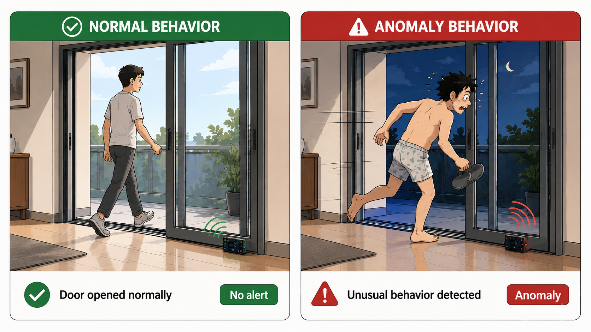
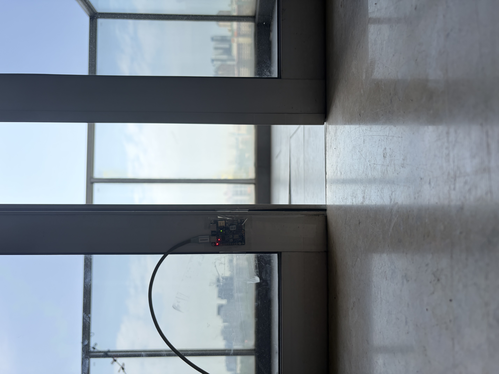
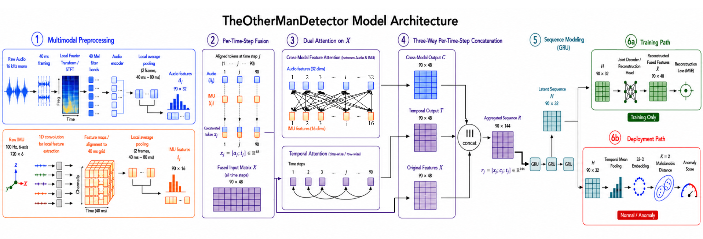

[English](README.md) | **中文**

# TheOtherManDetector | 隔壁老王检测器

> **你还在担心老婆出轨吗？**  
> **你还在担心长期出差在外，被隔壁老王偷家吗？**

为了保障异地夫妻的婚姻幸福生活，我们特此研发了 **TheOtherManDetector（隔壁老王检测器）**。

设想这样一个经典而令人不安的场景：

当你结束漫长的出差，终于回到家门口并敲响房门的那一刻，屋里的隔壁老王意识到大事不妙。正门显然已经不能走了，于是，他唯一合理的逃生方案就是：

**迅速拉开移门，从窗口跑路。**

问题来了。

正常人开门，和一个正在逃命的人开门，真的一样吗？

脚步的节奏、门体的振动、拉门的速度，以及整个过程中产生的声音，都可能暴露一些不太正常的行为模式。

于是，**TheOtherManDetector** 应运而生。

本项目利用同步采集的 **Audio + IMU 多模态信号**学习正常的移门交互模式。当系统检测到异常的脚步、异常的拉门动作或异常的声学与振动模式时，即可立即给出异常警报。

从技术角度来说，它实际上是一个运行于 **PSoC 6 MCU** 上的多模态 Edge AI 异常检测系统。

至于它究竟是在检测异常行为，还是在守护婚姻……

这取决于你怎么使用它。

---

## 概述

一个运行在 PSoC 6 上、做实时行为异常检测的 Audio-IMU 多模态 Edge AI 系统。

TheOtherManDetector 用一个 PDM 麦克风和一个六轴 IMU 分析移门周围发生的事件。它在边缘端运行，不用摄像头。系统检测的是和它学到的正常工作空间不一样的行为；它不识别具体的人，也不是步态身份识别系统。

仓库覆盖了从同步录制到嵌入式异常判决的完整链路：

```text
原始麦克风 + IMU 录音
              |
              v
      清洗与起始点对齐
              |
              v
     音频与 IMU 预处理
              |
              v
      重建式表征学习
              |
              v
    只含编码器的部署模型
              |
              v
          32 维嵌入
              |
              v
 StandardScaler + K=2 原型 +
 共享的 LedoitWolf 马氏距离精度矩阵
              |
              v
        导出 PT2 编码器
              |
              v
    DEEPCRAFT Model Converter
              |
              v
        生成的 C/H 模型
              |
              v
  PSoC 6 上的同步实时推理
```

原始数据集和清洗对齐后的数据集都包含在内。部署用的 PT2、转换器验证数据、拟合好的异常检测参数、生成的 C/H、ModusToolbox 描述文件和部署验证证据也都包含在内，所以构建固件不需要再跑一遍转换器。

## 场景一览

<p align="center">
  
</p>

## 硬件

固件的目标板是英飞凌 CY8CKIT-062S2-AI PSoC 6 AI 评估套件：

<p align="center">
  
</p>

板子装在移门下部靠开门一侧。IMU 采集门体和轨道的振动与运动，PDM 麦克风采集脚步声和开门声。

- PSoC 6 Cortex-M4 应用处理器；
- 板载 PDM 麦克风，采为 16 kHz 单声道 PCM16；
- BMI270 加速度计和陀螺仪，六轴 100 Hz；
- 无摄像头感知，本地推理。

传感器的时序、量程、增益和固定的事件窗口都是部署信号约定的一部分，不是运行时可调的参数。

## 数据集

清洗后的数据集有 164 个被接受的同步事件：

| 划分 | 样本数 |
|---|---:|
| 正常 训练 | 123 |
| 正常 验证 | 16 |
| 正常 测试 | 13 |
| 轻微异常 | 6 |
| 剧烈异常 | 6 |

有三个标注事件因为检测到的起始点之前不足 2.5 秒而被剔除。它们的记录和确切原因保留在元数据里。见 [dataset/README.md](dataset/README.md) 和 [dataset/dataset_manifest.csv](dataset/dataset_manifest.csv)。

## 信号处理

每个事件覆盖门体运动起始点前后 `[-2.5, +4.7)` 秒。

神经网络的音频输入不是原始波形。16 kHz 单声道 PCM 被切成 180 个不重叠的 40 ms 帧，每帧 640 个采样点。周期 Hann 窗、1024 点 FFT 功率谱、0–7000 Hz 上的 40 个 Slaney Mel 频带、`ln(mel + 1e-6)`，再按正常训练集做全局逐频带归一化，得到 `[180, 40]` 的音频特征。不做逐样本的幅度归一化。

IMU 输入是 100 Hz 的 `[720, 6]`，顺序为 `ax, ay, az, gx, gy, gz`，按正常训练集做全局逐轴归一化。网络把 IMU 的时序映射到同步的内部表征上。

离线的频率研究用了正常训练集 22,140 个 40 ms 频谱的累积和瞬态频谱能量。选 0–7000 Hz 去掉的 7 kHz 以上总能量约为 `0.416774%`。代码和分析表格 / 图在 [`analysis/`](analysis)。

## 模型结构

部署网络接收 `180 × 40` 的 log-Mel 音频特征和 `720 × 6` 的六轴 IMU 序列，输出一个 32 维嵌入。

<p align="center">
  
</p>

重建模型由这些部分组成：

- 一个 180 帧的音频特征编码器；
- 一个 IMU 时序编码器，把 720 行映射到公共的 180 帧网格；
- 固定池化到 90 个同步的全局 token；
- 有向二分图式的跨模态特征注意力；
- 完整的非因果时序注意力；
- 一层单向 GRU；
- 两个时序瓶颈卷积；
- 一个 23 × 32 的瓶颈和 32 维时序均值嵌入。

训练时联合使用一个 180 × 64 的重建解码器。部署时加载同一套编码器侧权重，去掉解码器，只输出 32 维嵌入。见 [docs/architecture.md](docs/architecture.md)。

## 异常检测

神经网络嵌入后面接一个外部拟合的判决头：

```text
嵌入 -> StandardScaler -> 到两个正常原型的距离
     -> 共享精度矩阵下的最小马氏距离 -> 阈值
```

KMeans 和 LedoitWolf 的拟合只在 PC 上做。MCU 存储拟合好的均值、尺度、两个原型和共享精度矩阵。正常嵌入空间用从正常训练集嵌入拟合出的 `K=2` 个原型表示。

基础阈值是 `5.692456722`，即正常验证集的最大值。固件另外施加一个单独命名的**部署安全系数** `1.05`，得到约 `5.977079558` 的部署阈值。运行时的判决规则是：

```text
score > 部署阈值   => ANOMALY（异常）
score <= 部署阈值  => NORMAL（正常）
```

## 模型转换

静态的、batch 为 1 的 PT2 接收 float32 的音频 `[1, 180, 40]` 和 IMU `[1, 720, 6]`，返回 `[1, 32]`。为了和转换器 / 运行时兼容，部署用固定的基于 tanh 的 GELU 近似，并把 GRU 拆成九个状态相连的十步块。不做量化。

[`converter/input`](converter/input) 里是部署用的 `embedding_model.pt2` 和 `converter_validation.npz`，[`converter/project.byom`](converter/project.byom) 存放可移植的 DEEPCRAFT 转换配置。生成的 C/H 模型已经在 [`firmware/model`](firmware/model)。见 [converter/README.md](converter/README.md) 和 [docs/deployment.md](docs/deployment.md)。

## 固件部署

ModusToolbox 应用持续采集两路传感器，识别开门事件，截取精确的窗口，对两路信号做预处理，调用 `TMAI_compute(imu, audio, embedding)`，给嵌入打分，然后通过 UART 输出 `NORMAL` 或 `ANOMALY`。

依赖是拉取的，不是随仓库附带的：

```powershell
cd firmware
make getlibs
make build CONFIG=Release
```

必须用 Release 构建，因为生成的网络要求 `-O3` 或 `-Ofast`。详细的构建、冒烟测试和烧录说明在 [firmware/README.md](firmware/README.md)。

## 结果

用当前的部署阈值，所附评估集里的全部 25 个样本都给出了预期的判决：

| 评估集 | 判决正确 |
|---|---:|
| 正常 测试 | 13 / 13 |
| 轻微异常 | 6 / 6 |
| 剧烈异常 | 6 / 6 |

在目标 PSoC 6 上做端到端原始数据回放，PC 与 MCU 的异常得分最大误差为 `5.72e-6`，判决不一致 `0/25`。

报告的结果描述的是所附数据集，不构成对现场普适准确率的声明。

PT2 与存储参考值的一致性最大绝对误差为 `0.0`；Python/C 的 K=2 检查没有判决不一致。见 [results/evaluation_summary.csv](results/evaluation_summary.csv) 和 [results/deployment_verification.md](results/deployment_verification.md)。

## 仓库结构

```text
dataset/       原始录音、清洗后的配对数据、元数据和清单
analysis/      0–7000 Hz 频率选择分析
training/      预处理、模块化模型、训练、拟合、导出
converter/     PT2、验证用 NPZ 和可移植的 DEEPCRAFT 工程
firmware/      可构建的 ModusToolbox 应用和生成的 C/H
tools/         可复用的、保持比特不变的数据集清洗工具
docs/          结构、部署理由和局限
results/       精简的评估与验证证据
```

## 快速开始

在仓库根目录下查看并复现 PC 侧流程：

```powershell
python -m venv .venv
.\.venv\Scripts\Activate.ps1
python -m pip install -r training/requirements.txt
python -m training.scripts.preprocess_dataset
python -m training.scripts.train
python -m training.scripts.fit_anomaly_detector
python -m training.scripts.export_model
```

这些命令把可复现性输出写到 `training/outputs/`，默认不会替换已入库的部署产物。单独重跑频率研究：

```powershell
python analysis/audio_frequency_analysis.py
```

## 已知局限

数据集比较小，而且绑定在特定的声学环境、麦克风通路、门的安装方式和 IMU 的安装位置 / 朝向上。没见过的正常行为可能得分偏高，背景噪声或机械上的域偏移会降低区分度。见 [docs/known_limitations.md](docs/known_limitations.md)。

## 作者

**Ethan_Xing**  
联系：`xyy051036@gmail.com`

## 许可

项目代码和文档按 [MIT 许可](LICENSE)发布。

`dataset/` 下的数据集按 [CC0 1.0 Universal](dataset/LICENSE) 发布。

第三方库、生成的依赖和厂商组件仍受各自许可约束。
